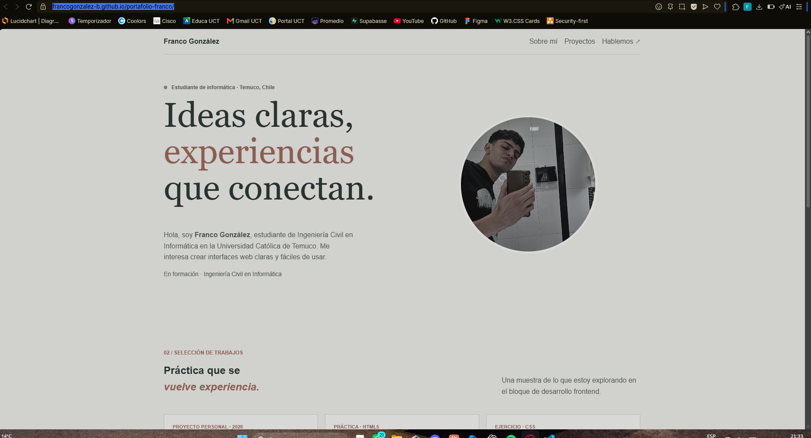

# Inventario de migración de la E2 a React

La referencia es el [portafolio de la Evaluación 2](https://github.com/FrancoGonzalez-B/portafolio-franco). Su repositorio se conserva aparte.

También se conservan las capturas móviles en `docs/referencias/`.

## Secciones, contenidos y recursos recuperados

| Elemento de la E2 | Implementación en la E4 |
| --- | --- |
| Cabecera con nombre y menú de tres secciones | `src/components/SiteLayout.tsx`; datos en `src/data/portfolio.ts` |
| Presentación, carrera, universidad y ubicación | `src/pages/HomePage.tsx`; contenido en `src/data/portfolio.ts` |
| Fotografía personal circular con borde | `public/images/franco-gonzalez.jpeg` y estilos de la presentación |
| Calculadora Gráfica de Límites, The ELEA y Backend Duro | `src/data/projects.ts`, renderizados con `ProjectCard` |
| Bloque de contacto verde oscuro | `src/pages/ContactPage.tsx` y sus estilos |
| Formulario con nombre, correo y mensaje | `src/components/ContactForm.tsx` |
| Correo de contacto y pie de página | Datos en `src/data/portfolio.ts`, usados en contacto y layout |
| Marfil, verde y terracota; títulos en Georgia | Variables de `src/index.css` y CSS modular |

La corrección de tildes y escritura en los títulos de proyectos conserva su significado. Los textos describen los trabajos de la E2; la lista consultada a GitHub se presenta como una sección adicional.

## Comportamiento original y migración

El HTML revisado de la E2 no cargaba archivos JavaScript. No se atribuyen al original funciones que no tenía: no había menú hamburguesa, cambio de tema ni filtro de proyectos programados con JavaScript.

| Comportamiento de la E2 | Recuperación o cambio en la E4 |
| --- | --- |
| Menú con enlaces de ancla hacia las secciones | React Router navega entre vistas y `NavLink` identifica la activa |
| Enlace “Saltar al contenido” | Control accesible que mueve el foco al `main` |
| Formulario con validación HTML y `action="mailto:..."` | Campos controlados, validación y mensajes desde estado de React; preparación de correo |
| Enlace de correo directo | Se conserva `mailto` |
| Adaptación a pantallas pequeñas con CSS | Estilos de móvil primero y ajustes por ancho |

## Modularización

- La estructura de `index.html` se distribuyó en páginas y componentes funcionales; `App` define las rutas y `main.tsx` inicia React.
- Los datos personales, la navegación y los trabajos se separaron del JSX en `src/data/`.
- Las props, los estados, los eventos y la respuesta de GitHub tienen tipos definidos en `src/types/`.
- Los estilos se separaron en reglas base y archivos por componente o página, con nomenclatura BEM.
- El formulario tiene un componente propio porque reúne estado, validación y confirmación.

## Funciones nuevas y mejoras de esta migración

| Adición o ajuste | Motivo |
| --- | --- |
| GitHub REST API | Mostrar repositorios públicos reales con carga, éxito, error, reintento y vacío |
| `AbortController` y caché de respuestas correctas | Cancelar peticiones pendientes al desmontar la vista y reutilizar datos al volver |
| Filtro local de repositorios | Encontrar trabajos sin repetir llamadas a la API |
| Tema claro/oscuro con Context | Compartir una preferencia entre las vistas y guardarla en el navegador |
| Ruta 404 y retorno al inicio | Resolver direcciones inexistentes de forma comprensible |
| Encabezados y mensajes accesibles | Mantener una jerarquía de lectura y comunicar cambios de estado |
| Ajuste de contraste en botones y texto de acento | Corregir problemas detectados en la primera versión React, especialmente en modo oscuro |
| CSS BEM | Dar nombres explícitos a bloques, elementos y variantes para evitar reglas ambiguas |

Los ajustes de contraste y encabezados se registran como correcciones de la primera migración a React. No se afirman errores del portafolio original que no hayan sido comprobados.

## Alcance

El formulario valida y prepara un correo para la aplicación del visitante. No existe un backend de entrega de mensajes. La API usa datos públicos y puede fallar por conexión o límites de GitHub. Las comprobaciones realizadas y sus límites se registran en [uso_ia.md](uso_ia.md).
