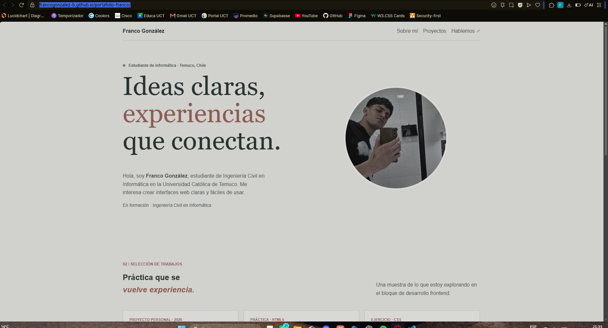
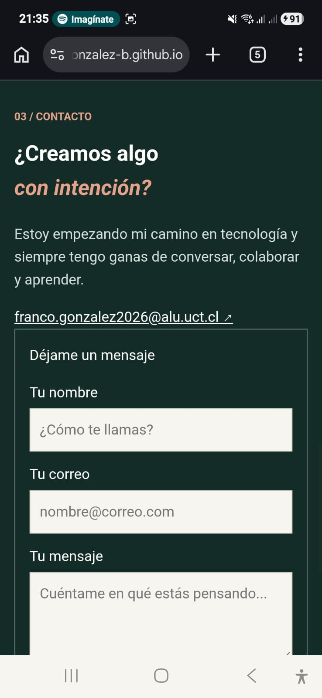

# Portafolio React de Franco González

Proyecto Integrado Final de Desarrollo Frontend. Esta versión migra el portafolio de la Evaluación 2 a React y TypeScript, conserva su identidad visual y agrega rutas, consumo de una API pública y estados de interfaz.

## Referencia visual: portafolio de la Evaluación 2

Se conservan la paleta marfil, verde oscuro y terracota, la tipografía serif de los títulos, la fotografía circular, las tarjetas de proyectos y el bloque oscuro de contacto.



También se adjuntan capturas de las vistas móviles originales:




El [repositorio original de la E2](https://github.com/FrancoGonzalez-B/portafolio-franco) se conserva aparte como referencia.

## Tecnologías

- React y TypeScript
- Vite
- React Router en modo declarativo con `HashRouter`
- CSS responsive
- GitHub REST API pública

## Requisitos y ejecución

Se requiere Node.js 20.19 o superior.

```bash
npm install
npm run dev
```

Vite mostrará en la terminal la dirección local para abrir el sitio. Para generar y revisar la versión de producción:

```bash
npm run build
npm run preview
```

## Rutas

La navegación interna usa React Router, no enlaces de ancla:

- `/#/sobre-mi`: presentación
- `/#/proyectos`: trabajos y repositorios de GitHub
- `/#/contacto`: información y formulario

Se usa `HashRouter` para que las rutas funcionen al publicar el sitio en un hosting estático como GitHub Pages, sin configurar un servidor para reescrituras.

## API pública

La sección de proyectos consulta el endpoint público:

```text
GET https://api.github.com/users/FrancoGonzalez-B/repos?type=owner&sort=updated&per_page=20
```

Se muestran repositorios propios con contenido, su nombre, descripción, lenguaje principal, estrellas y fecha de actualización. Los datos se definen con tipos TypeScript y la respuesta HTTP se comprueba antes de presentarse.

La interfaz distingue cuatro situaciones: carga, datos disponibles, error con opción de reintento y resultado vacío. El servicio guarda en memoria la respuesta correcta para evitar solicitudes repetidas durante la navegación. El filtro de repositorios se realiza localmente y no vuelve a consultar la API. No se necesita una clave secreta.

## Estado e interacciones

- `ThemeContext` comparte el tema claro u oscuro entre las rutas y lo conserva en `localStorage`.
- El formulario valida nombre, correo y mensaje; confirma la validación y prepara un enlace `mailto`. No envía datos a un servidor.
- El menú muestra la ruta activa y toda la navegación entre páginas usa React Router.
- El filtro de GitHub funciona sobre los datos ya cargados.

## Accesibilidad y diseño responsive

El sitio usa encabezados y elementos semánticos, texto alternativo para la fotografía, etiquetas asociadas a los campos, un botón para saltar al contenido, foco visible al usar teclado y estados de API anunciados con `role="status"` o `role="alert"`. Incluye estilos para preferencia de movimiento reducido.

El diseño parte de una columna para pantallas pequeñas. Desde 600 px las tarjetas pasan a dos columnas; desde 900 px la presentación y el contacto se distribuyen en dos columnas y las tarjetas en tres; desde 1200 px aumenta el espacio vertical.

## Organización del proyecto

```text
.
├── docs/
│   └── referencias/       # Capturas del portafolio de la E2
├── public/images/         # Fotografía del portafolio
├── src/
│   ├── components/        # Layout, tarjetas y lista de repositorios
│   ├── context/           # Estado compartido del tema
│   ├── data/              # Proyectos del portafolio
│   ├── hooks/             # Hook para repositorios de GitHub
│   ├── pages/             # Vistas enlazadas por React Router
│   ├── services/          # Petición y caché de la API
│   └── types/             # Tipos de TypeScript
├── INVENTARIO.md          # Funciones y contenidos recuperados de la E2
└── uso_ia.md              # Registro del uso de IA
```

## Flujo de trabajo con Git

La funcionalidad se trabaja en una rama y se integra a `main` mediante un pull request:

```bash
git switch -c feat/nombre-del-cambio
git add .
git commit -m "feat: describe el cambio"
git push -u origin feat/nombre-del-cambio
```

Después, crea un pull request hacia `main`. Antes de integrarlo, revisa el diff, prueba `npm run build` y confirma qué criterio de la rúbrica cubre el cambio. Para documentación usa mensajes como `docs: actualiza instrucciones`; para correcciones, `fix: corrige ...`.

## Documentación de la evaluación

- [INVENTARIO.md](INVENTARIO.md): contenido y funciones recuperados de la E2 y su correspondencia en React.
- [uso_ia.md](uso_ia.md): herramientas, prompt recibido, ajustes, verificación y reflexión final.
